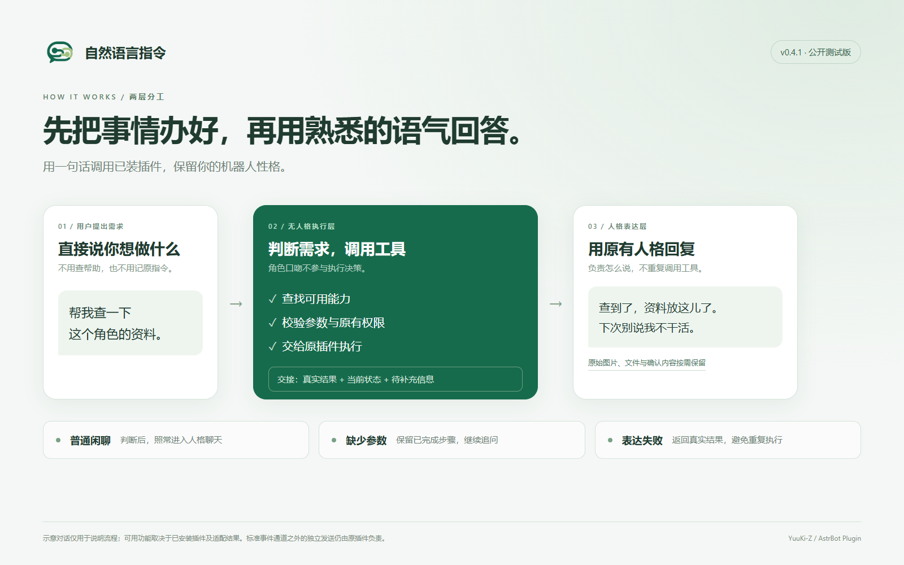
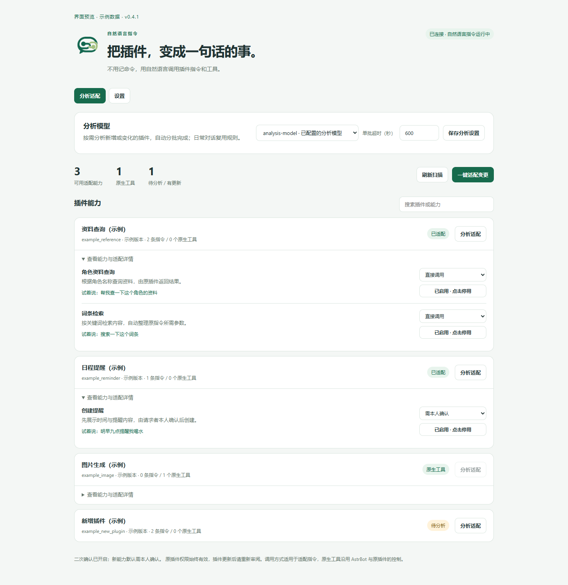
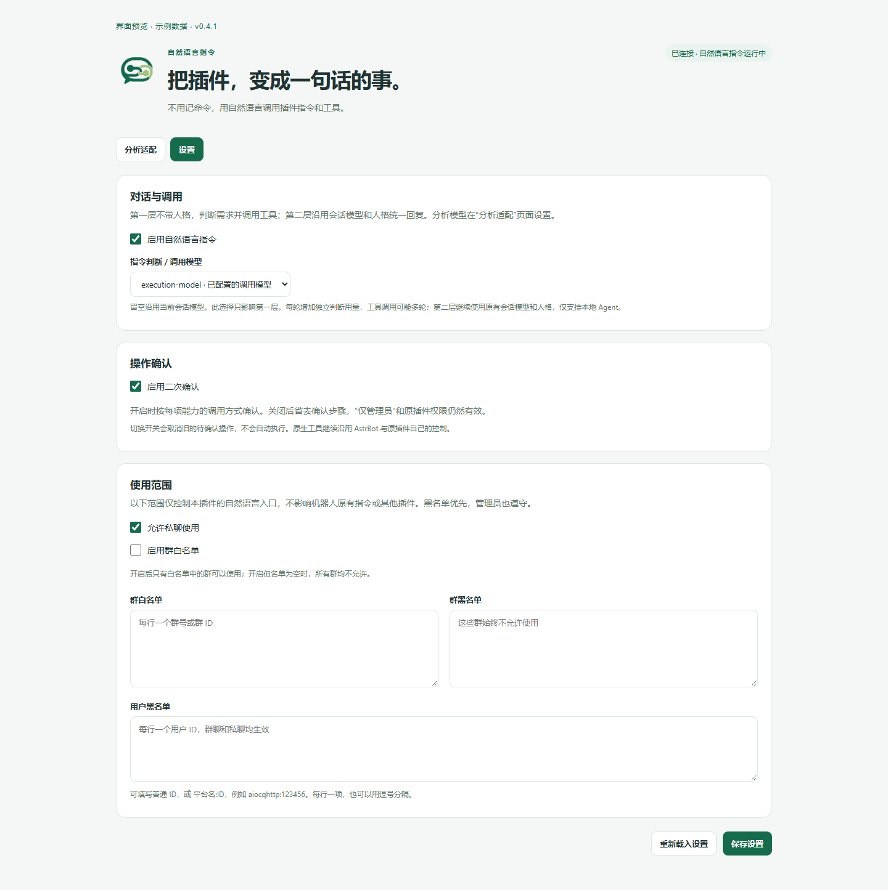

# 自然语言指令


**不用记命令，用自然语言调用插件指令和工具。**

装的插件多了，难免记不住每个功能该怎么用。明明只是想查一份资料、生成一张图片，却还得先翻帮助、找命令、确认参数。

「自然语言指令」想让这件事简单一点：告诉机器人你想做什么，让它寻找合适的插件来完成。

扫描已安装插件，通过模型生成并校验适配规则，让机器人理解用户需求、解析参数并调用原插件完成任务。支持能力检索、适配缓存和插件更新后重新适配。

这里的“适配”，就是先让模型了解插件已有的功能，整理出供机器人调用的规则。插件不预置特定业务的适配，而是根据你实际安装的插件进行分析。

目前为公开测试版，欢迎试用和反馈。



<details>
<summary>查看能力中心截图</summary>

以下为实际界面的浏览器截图，使用明确标注的示例数据展示；示例不代表插件预置这些适配。

**分析适配：** 查看插件能力、示例说法与调用方式。



**设置：** 管理指令判断模型、二次确认与使用范围。



</details>

## 能帮你做什么

- **直接说需求。** 用户用平常聊天的方式提出请求，机器人查找可用功能、整理参数，再交给原插件处理。
- **统一了解已装插件。** 在“能力中心”查看插件有哪些功能、哪些已经可以调用，也能单独启用或停用某项适配能力。
- **按需适配。** 选择一个分析模型，一键处理新增或变化的插件；也可以只分析某个插件。
- **复用已有结果。** 生成的规则会保存下来，日常聊天直接使用，不需要每次重新分析插件。
- **决定哪些操作可以直接做。** 管理员可以让常用查询直接调用，让其他操作先展示内容、等待本人确认，也能限制为仅管理员使用。

实际能完成什么，取决于已安装插件提供的功能、适配结果，以及聊天模型的理解和工具调用能力。

## 安装与开始使用

需要 AstrBot **4.29.0 或以上、5.0 以下**，以及支持工具调用的聊天模型。

在 AstrBot 后台选择“安装插件 → 从链接安装”，填写：

```text
https://github.com/YuuKi-Z/astrbot_plugin_capability_bridge
```

安装后：

1. 在插件页打开「自然语言指令」，进入可视化视图“能力中心”。
2. 在“分析适配”页面选择已在 AstrBot 中配置好的分析模型，点击“保存分析模型”。不需要重新填写 API Key。
3. 点击“刷新扫描”，查看当前安装的插件。这一步不调用分析模型。
4. 点击“一键适配变更”，等待分析完成；也可以在单个插件旁点击“分析适配”。
5. 展开插件详情，查看可用功能、示例说法，以及暂未适配的原因。确认功能用途后，可以为每项能力选择调用方式。
6. 像平时一样唤醒机器人，用自然语言提出需求。

## 聊天时怎么用

例如，装好相应插件并完成适配后，可以试着说：

> 帮我查一下这个角色的资料。
>
> 给我生成一张夕阳下的海边小屋。

机器人先通过不带人格的执行层判断需求、选择工具，由原插件完成查询或生成；再由当前人格统一表达结果、失败原因或必要追问。普通闲聊也经过第一层判断，再交给人格聊天。人格表达层不提供执行工具，不会再次决定是否执行或重复调用。

第一层不会加载人格提示或历史角色回复，仅参考近期用户消息和同一用户尚待补充的任务。待补充任务只保留在内存中，十分钟后失效。人格可以改变语气，不能改变执行事实、跳过必要追问或代替用户确认。

多步骤请求中，完成一项不会自动把整个任务标记为完成；仍缺信息时继续追问，已提交的异步任务也会保留其状态。如果人格模型调用失败、实际返回空回复或流式回复中断，系统会附上真实工具结果及原始附件，避免结果丢失；已执行的操作不会因此自动重做。防抖或过滤插件主动清空已生成的回复时，不会误报表达失败或发送内部工具结果；已生成的附件与确认内容仍保留。兼容处理由本插件完成，无需修改其他插件。

通过调用事件发送、返回或 yield 的文字会收集后交给人格层；图片、文件等保留原件，在人格回复后发送一次。确认码和最终参数也会原样附上，避免润色破坏确认内容。插件自行调用底层平台 API、持有独立发送通道或向其他会话发消息的行为不在此收集范围内；这些行为仍由原插件负责。涉及账号、权限或其他使用条件时，仍以原插件的要求为准。

自然语言请求需要先进入聊天模型流程。群聊里的 @唤醒、白名单等规则仍由 AstrBot 的现有配置决定；如果人格或工具配置限制了可调用的工具，也需要允许本插件的工具。

## 哪些操作需要确认

未经管理员审阅的适配能力，默认需要本人确认。你可以在“能力中心”为每项能力选择：

| 调用方式 | 使用体验 | 适合什么情况 |
| --- | --- | --- |
| 需本人确认 | 先展示要执行的指令和最终参数，确认后才执行 | 尚未审阅的功能，或会修改账号、设置等内容的操作 |
| 直接调用 | 用户提出需求后，机器人直接调用 | 管理员已经审阅的常用查询 |
| 仅管理员且需确认 | 只有当前会话的 AstrBot 管理员可以发起，并且仍需本人确认 | 清理、重置、权限调整等高影响操作 |

需要确认时，机器人会发送这一次操作的内容及 `/确认执行 确认码`。请本人在原会话发送该指令；确认码两分钟内有效，只能使用一次。更换会话、由别人代发，或确认前目标参数发生变化，都不会执行原先的操作。重启或重载本插件后，未完成的确认也会失效。

调用方式由管理员在后台设置，分析模型不能替你放行。无论选择哪一种，原插件的权限和使用条件依然有效。

如果不需要二次确认，可以在插件配置或“能力中心 → 设置”里关闭“启用二次确认”。关闭后，“需本人确认”会直接调用，“仅管理员且需确认”变成仅管理员直接调用。管理员限制和原插件权限始终保留。

切换开关会取消旧的待确认操作，旧请求不会因为关闭确认而自动执行。再次开启后，原先为每项能力选择的调用方式仍然保留。

目前的确认流程适用于能用文字参数完整描述的操作。依赖图片、引用消息或其他消息对象的操作，会提示使用原插件指令，避免确认消息改变了原来的输入；无需二次确认的调用不受此限制。参数太长、无法完整展示时，也会提示改用原指令。

这些调用方式适用于本插件生成的适配指令。**原生工具继续沿用 AstrBot 与原插件自己的调用控制，不经过这里的确认机制。** 如果同时安装了其他指令执行器，也需要单独检查它的权限设置。

## 设置在哪里

AstrBot 的插件配置页可以设置二次确认、两项模型，以及群聊和私聊的使用范围。“能力中心”也可以修改同一份配置：

- **分析适配页**：选择分析模型、扫描插件、生成适配、查看用量和每项能力的调用方式。
- **设置页**：选择指令判断 / 调用模型，管理总开关、二次确认、群白名单、群黑名单、私聊开关和用户黑名单。

两边共用 AstrBot 的插件配置，旧版已选择的分析模型会自动迁移。保存设置不需要重新分析插件。编辑多个页面时，如果提示设置已变化，请重新载入后再保存。

## 哪些群和用户可以使用

默认不限制群聊，并允许私聊。你可以按需要调整：

- **群白名单**：开启后，只允许名单中的群；开启但名单为空时，所有群均不允许。
- **群黑名单**：名单中的群始终不允许，优先级高于白名单。
- **私聊开关**：单独决定是否允许私聊使用。
- **用户黑名单**：名单中的用户在群聊、私聊中均不能使用。

名单填写群号或用户 ID，也支持 `平台名:ID`，例如 `aiocqhttp:123456`。UI 中每行一项，也可用逗号分隔。管理员同样遵守这些范围限制，原插件的权限要求依然有效。

这些设置只控制本插件的自然语言入口，不影响机器人原有指令、其他插件或它们的原生工具。修改使用范围或二次确认设置后，旧的待确认操作会失效，请重新发起需求。

## 装了新插件，或者插件更新了

回到“能力中心”，点击“刷新扫描”，再点击“一键适配变更”即可。已经适配且没有变化的插件会跳过。

检测到插件版本或源码变化后，旧适配会暂停使用，并提示重新适配。这样可以避免继续按旧规则调用已经变化的功能。

原先允许直接调用的设置不会自动沿用到变化后的插件，重新适配后恢复为需本人确认；已有的仅管理员限制会保留，等待重新审阅。全局关闭二次确认时依然跳过确认步骤，但不会取消管理员限制。

插件原本就提供给模型使用的工具，可以直接调用，无需额外生成适配。

## 兼容范围

本插件面向不同插件提供的指令和工具，尽量把它们整理成统一的自然语言入口。它负责理解请求和衔接调用，具体功能仍由原插件完成，因此原插件需要已经安装、启用，并完成必要配置。

自动适配还不能保证覆盖每个插件的全部功能。复杂的多轮交互、特殊调用流程，或模型未能理解的功能，可能暂时无法适配；“能力中心”会展示当前结果和原因。定时任务、自动消息监听等行为继续按原插件的方式运行，不会仅因被扫描到就变成可主动调用的工具。

目前主要验证环境为 **AstrBot 4.29.0 + QQ OneBot v11**。其他平台，以及依赖特定平台功能的插件，仍需要更多验证。AstrBot 或插件的后续更新也可能需要兼容调整。

## 模型与用量

这里有三个使用模型的环节：

| 环节 | 什么时候使用 | 使用哪个模型 |
| --- | --- | --- |
| 分析适配 | 你点击适配，整理插件功能时 | 在“能力中心”选择的分析模型 |
| 指令判断与调用 | 每轮判断用户需求，必要时调用工具 | 设置页选择的指令判断 / 调用模型，留空时沿用当前会话模型 |
| 人格表达 | 闲聊、结果说明、补充信息或确认后的回复 | AstrBot 当前会话模型及人格 |

三个环节可以使用同一个模型，也可以分开配置。

指定指令判断 / 调用模型后，它只用于允许会话中的第一层，不切换人格表达层的模型。此功能面向 AstrBot 本地 Agent，第三方托管 Agent 不使用此分层流程。原有该字段的模型选择会保留，但从此版本起仅影响第一层。

刷新扫描、查看功能列表不会调用分析模型。日常聊天复用已有适配，但每轮会增加一次独立判断请求；需要检索及执行工具时可能增加多轮请求，再由人格层生成回复。确认后的结果与异步后续文字也可能产生额外人格表达用量。只有你再次发起适配时，才会重新分析相应插件。

分析会自动拆成较小的批次，无需手动设置 token 预算。界面会显示当前批次、等待时间，以及模型是否正在思考或返回结果；模型不支持流式时显示等待状态。你也可以停止剩余分析。

单批超时默认 600 秒，可以在分析页或插件配置中调整。它决定一次请求最多等多久，不限制总用量；模型服务自身的超时仍然有效。中途失败或停止后，再次点击适配会复用已经完成并通过校验的批次；更换分析模型、插件源码或分析规则变化后会重新分析。

用量以服务商账单为准。页面分别展示服务商已报告的 tokens、已完成但未报告用量的响应估算，以及仍在进行或中断后用量未知的请求。未收到响应不代表没有费用，页面不会把发送前的预测当成实际消耗。

## 数据与权限

分析适配时，相关插件的功能注册信息和部分源码会发送给你选择的分析模型服务，用于理解它的用法。扫描不会读取插件的私有配置或账号绑定表。

分析模型沿用 AstrBot 已配置的凭据，本插件不另存一份 API Key。适配规则和设置保存在 AstrBot 的插件数据目录中，公开安装包不包含运行过程中生成的规则或账号数据。

调用以实际发起者的身份进行，并检查相应的插件状态、会话范围和权限。适配过程不修改原插件源码，卸载本插件即可停止通过此入口调用。

本插件会检查原指令及所属指令组的权限和使用条件，但不会重新经过 AstrBot 的完整消息处理流程。原插件如果依赖额外的消息监听器进行安全检查，仍需要单独验证。确认机制也不替代原插件自身的访问控制。

## 反馈与更新

遇到问题，欢迎到 [Issues](https://github.com/YuuKi-Z/astrbot_plugin_capability_bridge/issues) 反馈。请附上 AstrBot 版本、消息平台、相关插件版本、所用模型、复现步骤和错误提示，分享日志前请移除凭据、真实账号和聊天内容。

版本变化见 [更新记录](CHANGELOG.md)。

<details>
<summary>开发与测试</summary>

在 AstrBot Python 环境中，从本插件的父目录执行：

```sh
python -m unittest astrbot_plugin_capability_bridge.tests.test_bridge astrbot_plugin_capability_bridge.tests.test_policy astrbot_plugin_capability_bridge.tests.test_settings astrbot_plugin_capability_bridge.tests.test_layers -v
```

行为测试使用模拟成员、账号和发送通道，不调用付费模型，也不向真实会话发送消息。GitHub Actions 另行检查 Python 格式、静态问题和编译。

</details>

## 许可证

[MIT](LICENSE) · Copyright (c) 2026 YuuKi-Z
